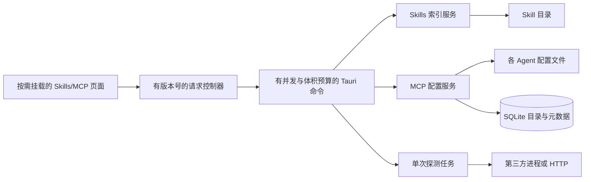

# Skills 与 MCP：资源生命周期和架构重设计

## 现状与判断

当前发布配置 `src/config/features.json` 为 `skillsMcp: false`，Rust 构建会排除 Skills/MCP 模块和命令，前端也屏蔽相应入口。因此，**当前运行中的正式应用若出现长期卡顿，不能直接归因于这两套被关闭的模块**。下述问题针对重新启用后的代码路径，是静态检查结论；要确认实际内存曲线，还需在隔离构建中做长时间采样。

| 路径 | 已发现的问题 | 影响 |
| --- | --- | --- |
| MCP 计划 | `McpState.plans` 原先只在 apply 时移除，未确认的计划不清理；每项保存完整 request、mtime 和 staging 操作 | 随用户反复预览而持续增长 |
| Skills 安装计划 | 每项保存完整计划及候选目录映射；原先仅查询该 ID 时移除过期项 | 反复生成、关闭预览后持续驻留 |
| MCP stdio 探测 | 工作线程阻塞读取子进程 stdout；超时后仅 kill 直接子进程，后代仍可能持有管道 | 线程与管道长期存活，第三方进程也可能继续占资源 |
| MCP 探测输入 | stdout `read_line` 与 HTTP `text()` 原先无响应体上限 | 第三方服务可造成瞬时内存峰值 |
| Skills 扫描 | `skills_scan` 全量验证每个 Skill，`skills_list_issues` 又全量扫描；每次包含目录遍历、大小统计和文件树相关验证 | 根目录大时造成 CPU、I/O 峰值和界面迟滞 |
| MCP 库 | 每次筛选从 SQLite 取全量 package、反序列化、去重、标记安装状态、排序，前端再只显示前 24 条 | 目录增长时跨 Rust/WebView 两端重复分配；搜索时尤为明显 |
| 前端状态 | Pinia 长期保存完整 Skills/MCP 列表；库页面虽分页显示，仍保留整个返回列表 | 页面离开后列表仍常驻；筛选只改变显示数量 |
| 远程内容 | README、远程 SKILL.md、skills.sh 包和自定义 MCP 源存在读取整份响应后再截断/校验的路径 | 不可信大响应引发短时峰值 |

这不是单一“泄漏”问题。计划表属于确定的生命周期缺口；全量扫描、全量目录传输和大响应属于有界性缺口。Rust/WebView 分配器可能在对象释放后仍保留堆页，因此系统监视器里看到的 RSS 不一定立即下降。

## 目标架构

### 1. 状态所有权

- Skills 配置和 MCP 配置继续以各自文件为事实来源；SQLite 只保存 MCP 目录、收藏与辅助元数据。
- 进程级状态只保存路径、短期操作令牌和小型索引版本号。计划令牌具有过期时间、数量上限、单次使用语义；关闭确认弹窗时可显式取消。
- 页面级状态只保存当前筛选页、所选条目和编辑草稿。离开页面时清理计时器和结果引用；较旧请求不得覆盖较新结果。
- 不在常驻状态中保存整个目录内容、配置文件全文、README 或探测工具全集。

### 2. 读取模型

- Skills 分成 `scan_summary` 与 `get_detail`：列表扫描只读取 frontmatter、mtime、基础校验摘要；文件树和深度校验只在进入详情或明确点“检查”时运行。按根目录维护版本戳，变更后仅刷新受影响根目录。
- MCP 服务扫描读取配置并合并实例，但以配置文件 mtime/内容哈希判断是否需要重解析。项目路径集合规范化后参与缓存键；缓存有明确数量和有效期。
- MCP 库查询在 SQLite 完成检索、排序和 `LIMIT/OFFSET`，命令返回 `items + total + nextOffset`；安装状态通过一次扫描生成小型键集合，避免对每个 package 遍历全部 service。
- 搜索采用一个活动请求版本号；新查询使旧结果失效。只有用户点“同步”才触发网络获取。

### 3. 工作预算

- 所有本地递归遍历统一限制最大深度、节点数、单文件读取字节和一次扫描总耗时；结果注明达到预算的目录，便于用户缩小范围。
- 所有远程响应在流式读取阶段设字节上限，不能先 `text()`/`json()` 再截断。目录同步限制单源 package 数和同时运行的同步数。
- stdio 探测每次独占一个进程组，10 秒截止，stdout 单条响应有大小上限；截止或完成后关闭 stdin、终止进程组、回收直接子进程并等待读取线程退出。HTTP 探测同样限制响应体。
- 后端同一时刻只允许一个重扫描和一个目录同步；其余同类操作由页面合并为最新请求，避免重复扫描争用磁盘与内存。

### 4. 写入与可观测性

- 保留现有计划预览、mtime 冲突检测、备份、原子写入与回滚语义。计划确认只引用短期令牌；apply 前重新验证目标文件版本。
- 记录每类操作的耗时、结果条数、读取字节、峰值候选数、计划表大小、探测进程数和超时数；日志不记录 env、headers 或密钥内容。
- 验收指标：空闲 30 分钟时 Skills/MCP 不执行扫描或网络任务；连续 100 次打开/关闭计划后注册表不超过 32 项且超过 15 分钟归零；搜索和翻页时 WebView 列表只保留当前页；探测超时后无残留探测进程和线程；超大远程响应在分配大对象前拒绝。

## 落地顺序

1. **生命周期修复**：限制并清理计划表；探测进程组与响应体；前端清理定时器并阻止旧请求覆盖新结果。本轮已开始落实。
2. **读取路径改造**：Skills 概览与深度验证拆开；MCP 库在数据库侧分页、筛选和排序；页面只保留当前页。
3. **统一预算与调度**：给远程读取和本地遍历建立共享预算，扫描与同步串行化或合并请求。
4. **实测与启用**：先在隔离构建中记录空闲、100 次操作和超大响应的内存/进程曲线，再决定是否恢复 `skillsMcp` 开关。

## 验证边界

本次源码检查能证明对象持有与无界读取路径，不能证明用户机器上既有卡顿的唯一原因。正式配置目前关闭两模块；若关闭状态仍卡顿，应同时检查剪贴板监听、用量同步和 WebView 渲染路径。
